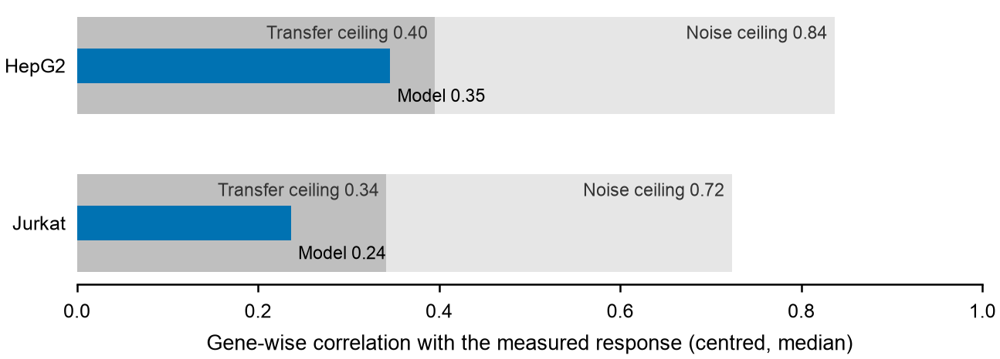

# zero-shot-perturbation

Predicting the transcriptional response to CRISPRi knockdowns in cell lines that have never been
perturbed, using only their unperturbed cells. This is my entry to the
[2026 Virtual Cell Challenge](https://arcinstitute.org/news/virtual-cell-challenge-2026)
(Arc Institute).

Since deep models do not yet beat simple linear baselines on this task
([Ahlmann-Eltze et al., 2025](https://doi.org/10.1038/s41592-025-02772-6)), I started from
transfer baselines: take the measured response of the same knockdown in other cell lines, combine
the sources and rescale to the target line.



## Main results

- The same knockdown agrees only moderately between cell lines: after noise correction the
  response correlates about 0.47 between HepG2 and Jurkat. A perfect copy of another line's
  response is therefore a ceiling for any transfer model, and the models are already close to it
  (HepG2: 0.35 against 0.40). What is left is response specific to the new line.
- Averaging several source lines gets the direction right but shrinks the effect size. Restoring
  the magnitude ("norm-restored transfer") gave my best validation leaderboard score (overall
  0.137, October 2026).
- None of the five uncertainty scores I tried ranks bad predictions usefully.

Per-round results, the local benchmark and all tables are in [docs/results.md](docs/results.md).

## Data

Public CRISPRi Perturb-seq screens, reduced to one pseudobulk profile per knockdown:

- K562 and RPE1, [Replogle et al., 2022](https://doi.org/10.1016/j.cell.2022.05.013)
- HepG2 and Jurkat, [Nadig et al., 2025](https://doi.org/10.1038/s41588-025-02169-3)
- HCT116 and HEK293T (X-Atlas/Orion), [Huang et al., 2025](https://doi.org/10.1101/2025.06.11.659105)

## Usage

```bash
uv sync
make data        # about 16 GB from figshare and GEO
make contexts    # pseudobulk per screen
make benchmark   # leave-one-line-out, scored with cell-eval2
make figures
make test
```

## Limitations

- Few source lines: a target measured only in K562 is effectively a K562 prediction.
- The direction of the response is inherited from the sources, not adapted to the new line.
- Knockdown depth differs between screens, so sources are not equally informative.
- Local scores are raw `cell-eval2` metrics on public lines, not leaderboard scores.

## License

MIT
